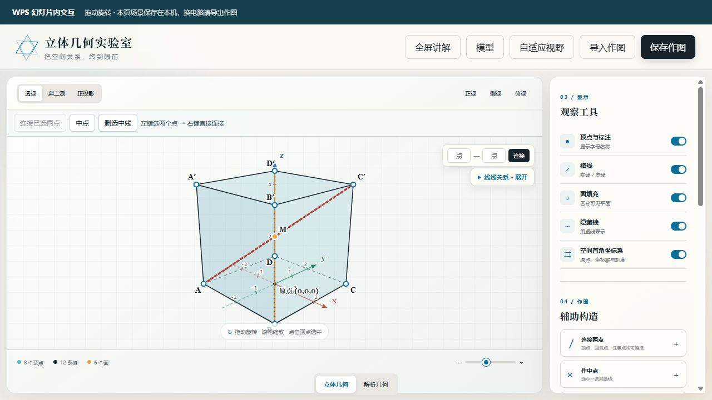

# 几何实验室

面向高中立体几何、解析几何的交互式教学工具。可在浏览器运行，也可通过支持网页对象的 Windows 版 WPS 演示在幻灯片中操作。纯 HTML、CSS、JavaScript，无 npm 运行依赖。

**[完整使用手册](docs/使用手册.md)**：首次安装、全部功能、课件放映、换电脑迁移、课堂例题与故障处理。下载项目后可直接打开 **[离线 HTML 手册](wps-help.html)**；WPS“使用说明”按钮也打开这份手册。



## 主要功能

- 16 种内置立体模型与自定义多面体；参数调整、透视／斜二测／正投影、标准视图、隐藏棱与半透明面。
- 底部空间直角坐标系；**左键选两个点，右键直接连线**；中点、三等分点、比例点、坐标点、圆弧点与自动交点。
- 线段长度、线线角、线面角与正射影、点到平面距离与垂足，附坐标和向量计算步骤；内置模型体积练习。
- 直线、圆、椭圆、双曲线、抛物线、一般二次曲线，多对象编辑、加点连线、支持范围内的求交及解析计算器。
- WPS 网页对象插入、铺满对象、16:9 页面设置、独立浮窗及放映自动打开浮窗。
- 工具栏常驻，模型选择可收起；全屏讲解；两种模式分别导入和导出 JSON。

## 浏览器快速开始

安装 [Node.js LTS](https://nodejs.org/en/download)，完整下载并解压项目，在项目文件夹中运行：

```powershell
node server.mjs
```

打开 `http://127.0.0.1:4173/`。保持终端开启，Ctrl+C 停止服务。不需要 `npm install`。

## WPS 首次安装

在项目文件夹中运行：

```powershell
powershell.exe -NoProfile -ExecutionPolicy Bypass -File .\install-wps.ps1
powershell.exe -NoProfile -ExecutionPolicy Bypass -File .\start-wps.ps1
```

先确认 `http://127.0.0.1:4174/` 能打开，保存工作后重开 WPS 演示。在“几何实验室”选项卡点击“插入当前幻灯片”，然后放映测试。每次开机后使用前运行启动脚本即可，通常无需重复安装。

内嵌交互依赖 WPS 的 `Shapes.AddWebShapeEx` 接口，**不是所有 WPS 版本都支持**。不支持时可尝试“打开交互窗口”，或使用浏览器版。网页工具测试不能代替目标 WPS 的插入、放映、保存及重开验收。

安装脚本只更新当前 Windows 用户的 `GeometryLab` 加载项条目，备份原配置并保留其他加载项。卸载命令：

```powershell
powershell.exe -NoProfile -ExecutionPolicy Bypass -File .\install-wps.ps1 -Uninstall
```

## 换电脑的关键步骤

1. 旧电脑逐页导出 JSON；同页使用两种模式时分别导出，按页码命名。
2. 复制**完整项目文件夹、PPT 课件、全部 JSON**。离线电脑还需预先准备 Node.js 安装包。
3. 新电脑安装 Node.js，以实际授课账户运行上述安装、启动脚本，重开 WPS。
4. 保持默认端口 **4174**，打开课件并逐页、逐模式导入 JSON，保存和试放映。

**仅复制 PPT 不会带走本机缓存或服务器程序。** 复制已有网页对象／幻灯片也可能共享场景编号；需要不同内容时，应分别新插入对象。详细流程见[手册第 7 节](docs/使用手册.md)。

## 练习文件

- [正方体体对角线与底面](examples/cube-diagonal.json)：在立体模式导入。
- [直线与圆求交](examples/line-circle.json)：在解析模式导入，再选两个画板对象求交。

## 开发与检查

```powershell
node --check app.js
node --check analytic.js
node --test tests/*.test.mjs
powershell.exe -NoProfile -ExecutionPolicy Bypass -File .\tests\install-wps.test.ps1
```

安装脚本测试在项目 `.local` 下构造临时配置，不修改真实 WPS 配置。`.local/` 用于运行日志、PID 和本地测试，已被 Git 忽略。不要把个人 PPT 和导出的课堂作图提交到公共仓库。

手册源文件为 `docs/使用手册.md`，根目录 `wps-help.html` 为生成的离线版本。仅维护者生成手册时需要 Python 和 Markdown 包：

```powershell
python -m pip install Markdown
python tools/build_docs.py
```

运行时不需要 Python。`server.mjs` 仅监听本机 `127.0.0.1`，项目不依赖外部 CDN。原生 API 模拟测试用于校验回调与错误处理，实际 WPS 兼容性以目标机器为准。
