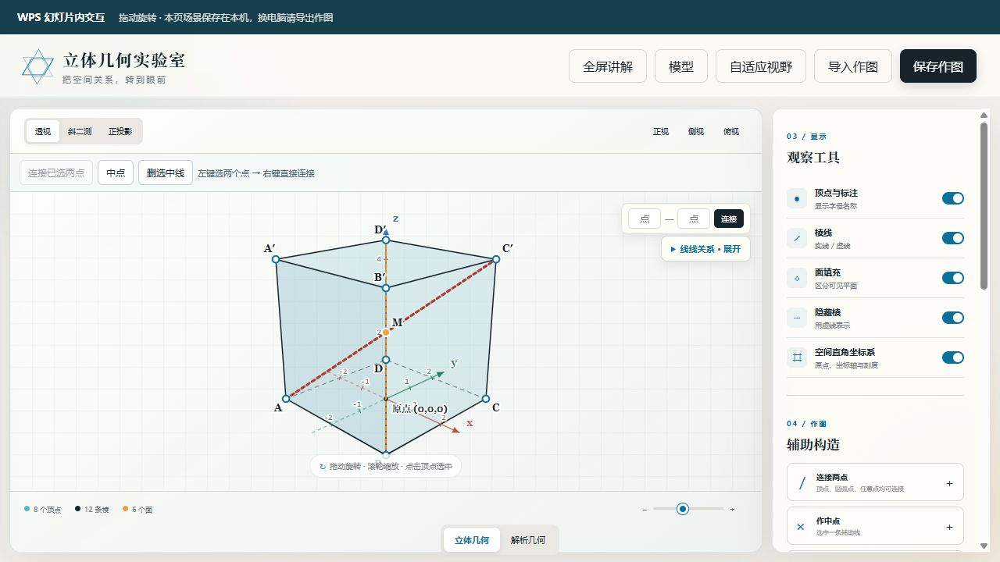

# 几何实验室使用手册

适用于高中立体几何、解析几何的备课、课堂演示和自主练习。本文覆盖项目中现有的操作功能，以及 Windows 电脑上的 WPS 安装、放映、保存、迁移和排错。

**换电脑使用需要三样东西：完整项目文件夹、PPT 课件、每页导出的作图 JSON。新电脑还要安装 Node.js，并使用支持相应加载项接口的 Windows 版 WPS 演示。仅复制 PPT 不能带走本机保存的作图。**

本项目使用本机网页服务。浏览器版可以单独运行；WPS 通过网页对象显示同一个工具。支持情况取决于目标电脑的 WPS 版本及管理策略，安装后应按下文完成放映验收。



## 目录

- [1 准备环境和下载项目](#1-准备环境和下载项目)
- [2 首次安装到 WPS](#2-首次安装到-wps)
- [3 在幻灯片内操作](#3-在幻灯片内操作)
- [4 通用页面操作](#4-通用页面操作)
- [5 立体几何全部功能](#5-立体几何全部功能)
- [6 解析几何全部功能](#6-解析几何全部功能)
- [7 保存和换电脑迁移](#7-保存和换电脑迁移)
- [8 两个完整练习](#8-两个完整练习)
- [9 常见问题](#9-常见问题)
- [10 当前能力边界](#10-当前能力边界)

## 1 准备环境和下载项目

### 1.1 需要什么

| 项目 | 要求与用途 |
| --- | --- |
| 操作系统 | 本文的 WPS 安装脚本用于 Windows；其他系统可另行尝试浏览器版，不使用这些 WPS 安装脚本 |
| WPS | Windows 桌面版 WPS 演示，支持 JS 加载项；内嵌放映还需要支持 `Shapes.AddWebShapeEx` 网页对象 |
| Node.js | 从 [Node.js 官网](https://nodejs.org/en/download)安装 LTS 版本；用来启动本机网页服务 |
| 浏览器 | 支持现代 JavaScript、SVG、localStorage 的浏览器；可先用 Edge 或 Chrome 检查页面 |
| Git | 可选；下载 ZIP 不需要安装 Git |
| 网络 | 首次下载、安装软件时需要；文件和运行环境准备好后，本工具的作图功能不依赖外部 CDN |

WPS 内嵌网页使用 [WPS WebShape 扩展接口](https://open.wps.cn/documents/app-integration-dev/wps365/client/wpsoffice/jsapi/wps-extension-api/kso/WebShape/obj)。不能仅凭“已经安装 WPS”就判断一定支持，具体以目标电脑实际插入及放映结果为准。

### 1.2 下载和解压

打开 [项目仓库](https://github.com/abotang/Geometer-s-Sketchpad)，选择 **Code → Download ZIP**，将 ZIP 完整解压到固定文件夹，例如 `D:\教学工具\Geometer-s-Sketchpad`。不要在压缩包预览窗口里运行脚本，也不要只复制 `index.html`。

熟悉 Git 的用户可以运行：

```powershell
git clone https://github.com/abotang/Geometer-s-Sketchpad.git
cd Geometer-s-Sketchpad
```

项目运行不需要 `npm install`，也不需要 Python。仓库中的 Python 文档生成脚本仅供维护者更新说明书使用。

### 1.3 打开命令窗口

在解压后的项目文件夹中打开 PowerShell。确认当前目录能看到 `index.html`、`server.mjs`、`install-wps.ps1` 和 `start-wps.ps1`。先输入：

```powershell
node --version
```

显示版本号才算 Node.js 已就绪。如果提示找不到 `node`，先安装 Node.js，再重新打开 PowerShell。

## 2 首次安装到 WPS

先保存正在编辑的课件。以下命令都在**项目文件夹**中执行：

```powershell
powershell.exe -NoProfile -ExecutionPolicy Bypass -File .\install-wps.ps1
powershell.exe -NoProfile -ExecutionPolicy Bypass -File .\start-wps.ps1
```

这里的执行策略参数只用于启动这次脚本进程，不永久修改系统执行策略；只对你已确认来源的本项目脚本使用。如果学校电脑由管理员限制脚本或加载项，请由管理员按其策略配置。

安装脚本将“几何实验室”注册到**当前 Windows 用户**的 WPS 加载项配置：

```text
%APPDATA%\kingsoft\wps\jsaddons\publish.xml
```

已有配置会先生成带时间戳的 `.bak` 备份。脚本保留其他加载项，只替换名为 `GeometryLab` 的条目，不会修改 `oem.ini` 或关闭 WPS。

随后按顺序操作：

1. 在浏览器打开 `http://127.0.0.1:4174/`，确认看到几何工具。
2. 保存课件后，完全退出并重新打开 WPS 演示，让加载项重新读取配置。
3. 查看功能区是否出现“几何实验室”选项卡。
4. 如果有网页信任提示，核对目标是本机地址 `http://127.0.0.1:4174`，按你所在单位的要求处理。
5. 用一张测试幻灯片插入几何网页，进入放映，测试选点、右键连线、旋转和保存。

安装后通常不需要每次重新注册。**每次开机后使用前，需要启动本机服务：**

```powershell
powershell.exe -NoProfile -ExecutionPolicy Bypass -File .\start-wps.ps1
```

启动脚本会检查服务是否已运行，成功后可关闭这个 PowerShell 窗口。Node 服务在后台运行，不会随 WPS 窗口关闭而自动退出；电脑重启后需要重新启动。

## 3 在幻灯片内操作

### 3.1 插入和放映

在 WPS 普通编辑视图选中目标页，点击“几何实验室 → 插入当前幻灯片”。新网页对象自动移动到页面左上角，并按当前幻灯片尺寸铺满。

进入放映后，在网页内操作。默认透视视图允许拖动旋转；立体几何中左键选中两个点，再在画布或顶点上按右键即可连接。点击“模型”可打开模型选择，右侧工具栏一直显示。狭窄窗口中工具栏可能排列到画布下方。

建议将交互图单独放在一页：铺满页面的网页对象可能遮住同页已有文字。讲课时保持项目文件夹可访问，并保持本机服务运行。

### 3.2 WPS 功能区全部按钮

| 按钮 | 功能与注意事项 |
| --- | --- |
| 插入当前幻灯片 | 创建新的内嵌网页对象，并分配新的本机场景编号；需要网页对象接口支持 |
| 铺满选中对象 | 在编辑视图中先选中一个几何网页对象，再点击此按钮；取消对象纵横比锁定、归零旋转和位置，并匹配幻灯片大小。它作用于所选形状，请不要误选其他图形 |
| 整份课件设为16:9 | 保持页面高度，调整整份演示文稿的页面宽度；所有页都受影响。之后再选中几何对象并铺满，检查其他页排版 |
| 打开交互窗口 | 打开独立网页浮窗；适合不支持内嵌网页的 WPS，前提是该版本支持网页对话框 |
| 放映时自动打开 | 本次 WPS 会话中，开始放映时自动打开独立浮窗；默认关闭，不代表自动插入网页对象 |
| 使用说明 | 打开这份完整的离线 HTML 手册 |

独立浮窗中的“返回放映”尝试关闭浮窗；若未关闭，手动点窗口右上角 ×。浮窗不是幻灯片内部的对象，使用方式和保存场景与内嵌对象不同。

### 3.3 全屏与黑边

网页右上角的“全屏讲解”会申请浏览器全屏、隐藏顶部宿主说明条并保留工具栏；“退出全屏讲解”恢复普通页面布局。宿主不允许浏览器全屏时，会给出提示并在现有网页区域内调整布局。浏览器允许时，也可按 Esc 退出全屏。

需要区分两种情况：

- **网页对象本身太小或偏移**：退出放映，选中几何网页，点“铺满选中对象”。
- **幻灯片之外有黑边**：检查课件与显示器的宽高比。16:9 屏幕可将课件改成 16:9 后再次铺满对象；比例不同的屏幕仍可能有黑边。网页不能自行消除 WPS 放映区域外的留黑。

更新项目后，重新进入网页以加载新版页面。功能区按钮有变化时，保存课件后重新打开 WPS。

## 4 通用页面操作

| 入口 | 功能 |
| --- | --- |
| 立体几何／解析几何 | 在空间模型与平面曲线之间切换，各自保留当前工作状态 |
| 模型 | 打开模型选择面板；在解析几何模式中显示曲线、方程参数和画板对象。点击面板 × 或遮罩关闭 |
| 自适应视野 | 调整当前模式的视野。立体模式恢复默认观察方向与缩放；解析模式重新计算适合对象的范围 |
| 保存作图 | 导出**当前模式**的 JSON，可继续编辑；不是图片、PDF 或 PPT 导出 |
| 导入作图 | 将相应模式的 JSON 恢复到当前画板；导入会替换该模式的当前场景，先保存需要保留的内容 |
| 全屏讲解 | 扩大可用显示区域，右侧工具栏保留 |

右侧面板可以上下滚动。两种模式的数据独立：同一页若同时使用立体和解析内容，要分别导出两份 JSON。

## 5 立体几何全部功能

### 5.1 内置模型和尺寸

点击“模型”，选择模型，再用滑块或数字框调整尺寸。数字框按界面范围限制输入。切换模型会清空当前模型的辅助构造和测量选择，切换前可先保存作图。

| 模型 | 可以调整的尺寸 |
| --- | --- |
| 正方体 | 棱长 AB |
| 长方体 | AB、BC、AA′ |
| 三棱柱 | 底面三边 AB、BC、CA，侧棱 AA′ |
| 五棱柱 | 正五边形底面的半径、侧棱 |
| 六棱柱 | 正六边形底面边长 AB、侧棱 AA′ |
| 三棱锥 | 底面三边 AB、BC、CA，侧棱 SA、SB、SC |
| 四棱锥 | 矩形底面 AB、BC，侧棱 SA；本模型顶点位于底面中心上方，各侧棱等长 |
| 五棱锥 | 正五边形底面的半径、锥高 |
| 六棱锥 | 正六边形底面的半径、锥高 |
| 正八面体 | 棱长 |
| 三棱台 | 下底三边 AB、BC、CA，上底 A′B′，侧棱 AA′ |
| 四棱台 | 下底 AB、BC，上底 A′B′，侧棱 AA′ |
| 圆柱 | 半径、高 |
| 圆锥 | 半径、高 |
| 圆台 | 下底半径、上底半径、高 |
| 球 | 半径 |

三角形不等式、锥高、棱台比例等条件不满足时，会显示参数错误；图上可能仍是上一次有效模型。应先修正参数，再测量或导出。

### 5.2 视图与显示开关

- **透视**：近处显大、远处显小，适合空间感知。左键拖动画布空白处旋转。
- **斜二测**：使用固定画法观察，不支持自由拖动旋转；需要旋转时切换到透视或正投影。
- **正投影**：平行投影，可以拖动旋转。
- **正视、侧视、俯视**：快速切换标准观察方向。
- **滚轮、底部缩放滑块**：调整图形大小。底部同时显示顶点、棱和面的数量；圆柱等曲面模型显示对应曲面统计。
- **顶点与标注**：显示或隐藏可选点与字母。需要鼠标选点时请打开。
- **棱线**：控制棱线显示。
- **面填充**：控制半透明面的显示。
- **隐藏棱**：控制背面棱的虚线显示。
- **空间直角坐标系**：控制原点、三轴、刻度与箭头显示。

对于水平底面的常用模型，坐标原点放在底面顶点的中心，x、y 轴在底面内，z 轴向上；坐标轴随模型一起旋转，负向以虚线表示。自定义模型则按最低 z 值的顶点平均位置确定原点，不会自动识别任意倾斜底面。球的原点在底部，不能把它当成球心坐标。

### 5.3 左键选点和右键连线

1. 左键单击第一个点，点会被选中。
2. 左键单击第二个点，上方显示两个已选点的名称。
3. 在画布空白处或顶点上按右键，立即连接两点。
4. 连接后清空点选状态，可继续选择下一对点。重复连接同一对点只会选中已有辅助线。

再次左键点已选点可取消选择。已有两个点时再选第三个点，会保留最近选中的两个点。顶点、已添加的中点、三等分点、任意点、圆弧点、交点均可作为端点。

另外还有三个连线入口：画布上方“连接已选两点”、右侧“连接两点”、画布右上角两个点名字输入框。输入如 `A` 和 `C′` 后点击“连接”或按 Enter；输入字母后带普通英文单引号也可表示带撇点，例如 `C'`。

触屏或没有右键时用“连接已选两点”按钮。键盘可 Tab 聚焦点，再用 Enter 或空格选择。右键快捷连线目前只用于立体模式。

### 5.4 中点、分点、任意点和圆弧点

| 操作 | 方法 |
| --- | --- |
| 作中点 | 先点击辅助线，再点画布上方“中点”或右侧“作中点”。上方“中点”也可对已选的两个点先连线再取中点 |
| 作三等分点 | 选中辅助线后点击“作三等分点”，得到从第一个端点起 1/3 和 2/3 处的两个点 |
| 在线段上取任意点 | “添加任意点 → 在线段上取点”，选择辅助线后输入比例 t，范围 0～1。t=0.5 为中点，t=0.25 为从线段第一个端点起的四分之一处 |
| 按坐标添加点 | “添加任意点 → 输入空间坐标”，输入 x、y、z 和不重复的点名。新点坐标以显示的底部原点为准 |
| 圆弧取点 | 圆柱、圆锥、圆台、球可启用“圆弧取点”，单击高亮圆周吸附添加一个点，完成后自动退出；拖动旋转不会连续撒点 |
| 自动交点 | 辅助线之间或辅助线与棱真正相交时，自动标出交点。投影图上看似交叉的异面线不会因此生成交点 |

取分点前建议明确点击目标辅助线。圆柱、圆锥等图形中的轮廓标记点会随观察方向变化；要研究固定圆周点的关系，请用“圆弧取点”创建固定点。

### 5.5 删除与关系观察

点击辅助线后可使用画布上方“删选中线”、右侧“删除线段”，或 Delete／Backspace 删除。不要在输入数字或文本时使用删除快捷键。依赖失效的交点会同步清理。

“清除辅助构造”删除辅助线和辅助点，保留模型。当前没有覆盖所有操作的通用撤销历史；需要保留的构造请先导出 JSON。

画布右上“线线关系 · 展开”会列出平行、垂直及方向夹角，含辅助线。该面板用于观察与数值核对，不是自动证明器；同方向的重合线也可能归到同一组。圆滑模型不会枚举大量网格棱作为普通几何棱。

### 5.6 空间角与距离

在右侧向下滚动到“空间角与距离”。选择测量类型，再从下拉框指定点。数据和辅助图会随尺寸变化更新。

| 测量 | 选点 | 显示内容 |
| --- | --- | --- |
| 线段长度 | U、V | 两点间距离、向量和长度公式 |
| 线线角 | 两条直线各两个不同端点 | 方向向量、点积公式、较小夹角；适用于异面直线 |
| 线面角与正射影 | 直线两点、平面上三个不共线点 | 角度、单位法向量、正射影、垂足 H₁/H₂ |
| 点到平面距离与垂足 | 待测点 P、平面三个不共线点 | 距离、垂足 H 的坐标、法向量法计算步骤 |

点“查看坐标与计算步骤”展开推导。角度采用 0°～90° 的较小角。线面角用正弦公式计算，不是直接把直线和法向量的夹角当答案。

图中绿色线段表示正射影，橙色虚线表示垂线。着色三角形只标示平面位置，计算的平面无限延伸，因此垂足可以落在三角形外。直线垂直于平面时，正射影退化为一点。

正方体、长方体提供“体对角线与底面”“顶点到底面”“异面棱夹角”三个快捷例题，使用当前尺寸，保留已有辅助构造。端点重合、平面三点共线或已删除的点不能参与相应测量，界面会提示重新选择。

### 5.7 体积练习

右侧底部显示当前模型的体积练习。先独立计算，再点“查看公式与计算”。内置模型分别采用柱体、锥体、台体、球或正八面体公式，并随参数变化更新。任意自定义多面体没有自动体积练习卡。

### 5.8 自定义多面体

“模型 → 任意多面体 → 打开编辑器”，粘贴顶点与面的 JSON 后生成。顶点编号从 0 开始；每个面按边界顺序列出顶点，建议各面采用一致的外侧绕序。示例四面体：

```json
{
  "vertices": [[0,0,0],[4,0,0],[0,4,0],[0,0,4]],
  "faces": [[0,2,1],[0,1,3],[1,2,3],[2,0,3]],
  "labels": ["A","B","C","S"]
}
```

至少 4 个顶点和 4 个面；每个面至少 3 个不同顶点。`labels` 可省略，填写时须与顶点一一对应、名称唯一且不超过 12 个字符。软件会从面边界生成棱。输入检查不等于完整的几何拓扑验证，请自行保证各面共面、边界正确且模型封闭。

## 6 解析几何全部功能

### 6.1 选择方程与调整参数

点击底部“解析几何”，再点击顶部“模型”打开曲线面板。

| 类型 | 输入与约定 |
| --- | --- |
| 直线 | `Ax + By + C = 0`，A、B 不得同时为 0 |
| 圆 | 圆心 (h,k)、半径 r，r > 0 |
| 椭圆 | 中心 (h,k)、a、b，本界面约定 a ≥ b > 0，长轴沿 x 轴；a=b 时为圆 |
| 双曲线 | 中心 (h,k)、a、b > 0，实轴可选择横轴或纵轴 |
| 抛物线 | 顶点 (h,k)、p > 0，选择向右、向左、向上、向下；采用 `y²=2px` 一类约定，顶点到焦点距离为 p/2 |
| 一般二次曲线 | `Ax²+Bxy+Cy²+Dx+Ey+F=0`，A、B、C 不得全部为 0，可表达带 xy 项的二次曲线 |

参数错误时显示提示，先修正再加入画布。一般二次曲线的判别式只能初步分类，不能单独判定退化、空集等所有情况。

### 6.2 多曲线画板

1. 选择类型、输入参数，查看虚线预览和当前方程。
2. 点“＋ 加入画布”保存为画板对象。
3. 点“新建”开始同类型的新草稿，或切换其他曲线类型，继续加入对象。
4. 点击“画板对象”列表中的对象名称重新编辑；修改有效参数会同步该对象，“更新对象”可再次确认。
5. 列表的圆点按钮控制显示，颜色框改变颜色，× 删除单个对象，“清空曲线”删除全部已加入曲线。

清空曲线后，当前方程的草稿预览可能仍在；这不表示已保存对象没有删除。求交下拉框只列出已加入且可见的对象，草稿不参与。

### 6.3 平面视野、加点和连线

- 默认拖动画布平移，滚轮缩放。x、y 单位长度相同，圆不会因画布宽高不同变成椭圆。
- 指针移动时显示坐标读数；“自适应视野”恢复适合当前对象的范围。
- “＋ 添加一个点”开启单次放点，单击画布添加一点后自动回到平移模式；拖动不会加点。
- “撤销最后一点”删除最后添加的点及依赖它的线段。
- 右侧“精确添加点”可输入点名、x、y，添加坐标点。
- 从两个点下拉框中选择端点，点“连接线段”。解析模式不使用立体模式的右键连线快捷操作。
- “清除点”会同时清除点与连接这些点的线段。

### 6.4 解析计算器与曲线性质

| 区域 | 能计算什么 |
| --- | --- |
| 两点 P、Q | 距离、中点、斜率、两点确定的直线；重合点不能唯一确定直线，竖直线斜率不存在 |
| 点 P 到直线 L₁ | 输入一般式系数后计算距离，显示点到直线公式；不依赖 Q 是否填写 |
| 直线 L₁ 与 L₂ | 判断平行、重合，或计算交点和较小夹角 |
| 画板对象求交 | 两直线，或一条直线与圆、椭圆、双曲线、抛物线、一般二次曲线；求得的实交点加入画板 |
| 曲线性质 | 直线斜率与法向量、圆心半径、椭圆焦点/焦距/离心率/准线、双曲线焦点/离心率/渐近线、抛物线顶点/焦点/准线、一般二次曲线判别式 |
| 公式推导 | 展开查看当前类型的斜率、圆心半径、焦点或二次曲线分类计算 |

计算器输入框是计算辅助，不会自动把 P、Q、L₁、L₂ 加入画板。需要绘图时，请通过方程对象或“精确添加点”添加。

**求交范围**：目前不支持任意两条二次曲线求交，如圆与圆、椭圆与双曲线。重合对象的无限多个交点不会枚举；“没有实交点，或两直线平行”的提示也不用于证明两对象一定相离。生成的解析交点是当前坐标快照，之后修改曲线时不会自动跟随，需要重新求交。一般二次曲线使用数值绘制，极端参数或视野可能影响显示精度。

## 7 保存和换电脑迁移

### 7.1 各种保存分别保存什么

| 保存方式 | 内容 | 是否随 PPT 自动迁移 |
| --- | --- | --- |
| WPS 保存课件 | 网页对象所在页、位置、尺寸、网址等课件内容；网页对象的保留仍需在目标 WPS 验收 | 课件内的信息随 PPT 文件移动 |
| 本机自动缓存 | WPS 每个新插入对象对应的两种模式场景和当前模式；浏览器版按当前来源保存场景 | 否；本机浏览器或 WPS 缓存，不是 PPT 附件 |
| 立体模式“保存作图” | 模型、尺寸、自定义模型、辅助点线、视图、显示开关、测量选点 | 需自行复制 JSON |
| 解析模式“保存作图” | 当前曲线草稿、参数、画板曲线、点、线段和视野 | 需自行复制 JSON |

解析计算器中临时输入的 P、Q、L₁、L₂，不在当前作图 JSON 中。两种模式各自导出，没有“一次导出整份 PPT 所有页”的功能。JSON 不是截图，导入后仍可继续编辑。

同一台电脑也不要把自动缓存当唯一备份。清理浏览器或 WPS 缓存、更换 Windows 用户、更改访问主机名或端口，都可能导致原缓存不可见。`localhost` 与 `127.0.0.1` 也应视为不同访问来源，建议始终沿用默认地址。

### 7.2 旧电脑打包清单

1. 打开课件的每个交互页，进入已完成的作图。
2. 在立体模式点“保存作图”，将 JSON 重命名，例如 `第03页-立体-体对角线.json`。
3. 同页如还使用解析模式，切换后再导出，例如 `第03页-解析-直线与圆.json`。
4. 对其余交互页重复以上步骤，另存一份页码与 JSON 的对应清单。
5. 保存 PPT，并复制完整项目文件夹、PPT、全部 JSON 到 U 盘或其他迁移目录。不要将个人课件和作图误提交到公共仓库。
6. 如果新电脑离线，提前备好适合该电脑的 Node.js 安装包，并确认 WPS 已安装。

推荐文件组织：

```text
教学迁移包/
  Geometer-s-Sketchpad/   ← 整个项目
  我的课件.pptx
  作图/
    第03页-立体-体对角线.json
    第03页-解析-直线与圆.json
  页码与作图对应表.txt
```

### 7.3 新电脑恢复步骤

1. 将迁移包复制到新电脑的固定文件夹，不要直接依赖容易拔出的 U 盘运行。
2. 安装 Node.js，打开 PowerShell，确认 `node --version` 有输出。
3. 进入项目文件夹，按第 2 节运行安装和启动脚本。注册应在实际授课使用的 Windows 账户下进行。
4. 在浏览器确认 `http://127.0.0.1:4174/` 可打开，保存工作后重新启动 WPS。
5. 打开复制来的课件，进入对应交互页。第一次可能显示默认正方体，这是尚未恢复本机场景。
6. 在立体模式导入该页的立体 JSON；需要解析内容时，切到解析模式导入对应解析 JSON。
7. 切回希望放映时显示的模式，稍候等待本机自动保存，再逐页检查。
8. 保存课件，并完成下面的验收清单。

项目文件夹路径可以不同，因为网页对象使用本机网址。**默认端口 4174 应保持一致。** 如果目标 WPS 不保留或不支持已有网页对象，先测试新插入对象；支持新对象时，可重新插入并导入该页 JSON。接口完全不支持时只能使用独立浮窗或浏览器版。

### 7.4 多页和复制幻灯片

每次点击“插入当前幻灯片”会创建新的场景编号。**复制现有网页对象或整页幻灯片会保留原网址，因而可能共享同一个本机场景。** 需要不同内容的页面，应各自新插入对象，再导入各自 JSON。

在普通浏览器打开默认首页，并不等于打开某个 WPS 页面的场景。独立浮窗也使用自己的场景；要交换内容，请通过 JSON 导出和导入。

### 7.5 课前验收清单

- 本机首页能打开，页面没有脚本错误提示。
- WPS 出现“几何实验室”功能区，目标页网页正常显示。
- 放映时能拖动旋转，左键选两个点后右键能连接。
- 工具栏可见，模型面板能打开和关闭，全屏／退出后布局正常。
- 每个交互页恢复了对应 JSON，复制页面没有意外共享场景。
- 立体测量、解析曲线和需要的参数正确。
- 保存课件，退出放映再进入；必要时重开 WPS，确认场景恢复。
- 断网后仍能使用本机工具；关闭本机服务会使网页加载失败，授课时应保持服务运行。

## 8 两个完整练习

### 8.1 正方体的体对角线与底面

1. 选择正方体，棱长设为 4。
2. 左键选择 A、C′，右键连接体对角线。
3. 在“空间角与距离”点“体对角线与底面”。
4. 展开计算步骤，得到线面角约 35.2644°；绿色线段为底面上的正射影。
5. 点“顶点到底面”，得到距离 4。
6. 点画布上方“中点”，可对选中的体对角线添加中点。
7. 在体积练习中展开核对：体积为 64 立方单位。

也可以在立体模式导入 [正方体练习 JSON](../examples/cube-diagonal.json)。例题的测量值是数值核对，解题时仍应完成几何证明或向量推导。

### 8.2 直线与圆求交

1. 切到解析模式，选择圆，令 h=k=0、r=4，点“加入画布”。
2. 选择直线，令 A=1、B=-1、C=0，点“加入画布”。
3. 在“画板对象求交”选择这两个对象，点“求交并加点”。
4. 两个交点约为 (2.828,2.828)、(-2.828,-2.828)。
5. 用点下拉框将两个交点连接，再导出作图。

也可以在解析模式导入 [直线与圆练习 JSON](../examples/line-circle.json)，再执行求交。

## 9 常见问题

| 现象 | 检查和处理 |
| --- | --- |
| `node` 不是命令 | 安装 Node.js LTS 后重新打开 PowerShell，运行 `node --version` |
| 脚本无法运行 | 确认 ZIP 已解压，当前目录正确，使用本文完整的 `powershell.exe ... -File` 命令；受学校策略限制时联系管理员 |
| 没有几何实验室选项卡 | 先启动本机服务，再保存课件并完全重开 WPS；确认在安装时使用的同一 Windows 账户、WPS 演示组件，且版本支持 JS 加载项 |
| 浏览器和 WPS 都打不开页面 | 重新运行启动脚本；检查 `.local/wps-server-error.log` 和 `.local/wps-server.log`，确认端口未冲突 |
| 浏览器能用，WPS 空白 | 检查网页信任提示、加载项加载情况、WPS 接口支持、对象网址与端口；重开网页和 WPS 后测试 |
| 提示不支持网页图形 | 当前 WPS 无所需接口。尝试“打开交互窗口”；若也不支持，使用浏览器版 |
| 放映后仍不能点击网页 | 先确认点击焦点在网页内，并在同一 WPS 版本测试新插入对象；若宿主不提供放映交互，改用独立浮窗，不能用静态预览图替代交互 |
| 右键弹出 WPS 菜单、没有连线 | 确认已左键选中两个点，指针在网页画布中；也可点“连接已选两点”。宿主若拦截右键，用按钮完成同一操作 |
| 无法旋转 | 检查是否在斜二测模式；切到透视或正投影，在画布空白处左键拖动 |
| 点选不到 | 打开“顶点与标注”；缩放或换观察角度避开重叠；也可输入点名连线 |
| 图形被截断、网页偏移 | 退出放映，选中网页对象后“铺满选中对象”；页面内再点“自适应视野” |
| 两边黑边 | 核对幻灯片与屏幕比例，见第 3.3 节；改 16:9 会影响整份课件 |
| 新电脑出现默认图形 | 原场景保存在旧电脑缓存；按第 7 节逐页导入 JSON |
| 两页内容一起变化 | 检查是否复制了同一个网页对象。新插入独立对象后导入各自作图 |
| 导入 JSON 报错 | 检查当前模式是否匹配文件类型，文件是否完整，是否误选了其他 JSON；先保留原文件再排查 |
| 线面测量报共线或重合 | 更换定义直线或平面的点；确定平面必须用三个不共线点 |
| 调尺寸后图形没变 | 查看参数错误提示；无法组成有效几何体时保留的是上一幅有效图形 |
| 曲线求交无法完成 | 两个对象须已加入且可见、不能是同一对象；当前仅支持两直线或直线与二次曲线 |

### 9.1 更换服务端口

优先保留默认端口，避免旧课件网址失效。确需更换时，安装和启动脚本必须使用相同端口，例如：

```powershell
powershell.exe -NoProfile -ExecutionPolicy Bypass -File .\install-wps.ps1 -Port 4180
powershell.exe -NoProfile -ExecutionPolicy Bypass -File .\start-wps.ps1 -Port 4180
```

重新打开 WPS 后新插入的网页使用新端口；**已有对象不会自动改网址**，原端口的本机缓存也不会自动迁移。先导出 JSON，再在新端口下新插入并导入；浏览器检查地址相应改为 `http://127.0.0.1:4180/`。

### 9.2 更新、前台运行和卸载

更新前保存课件并导出重要作图。下载新版解压到固定位置；不要在服务运行时移动项目文件夹。使用 Git 的用户先处理自己的本地修改，再拉取更新。网页修改后刷新或重新进入，功能区修改后重开 WPS。服务器本身更新后，应在确认无人使用时重启服务；不确定后台进程时，可重启电脑后在新目录运行启动脚本。

需要查看实时日志，或希望能用 Ctrl+C 停止服务，可不用后台启动脚本，直接运行：

```powershell
node server.mjs --port 4174
```

此时必须保持该终端打开，按 Ctrl+C 结束服务。不要与后台服务在同一端口重复启动。只用浏览器、不用 WPS 时也可运行 `node server.mjs`，默认打开 `http://127.0.0.1:4173/`。

卸载加载项：

```powershell
powershell.exe -NoProfile -ExecutionPolicy Bypass -File .\install-wps.ps1 -Uninstall
```

保存课件后重开 WPS 生效。卸载只移除加载项注册，不删除 PPT、JSON、项目文件、本机缓存，也不会自动停止已运行的 Node 服务。彻底停用前请自行备份需要的课件和作图。

## 10 当前能力边界

本工具提供几何可视化、辅助构造、特定测量和公式核对。它没有通用自动证明、任意三点截面裁切、通用二面角构造、完整符号代数系统、覆盖所有动作的撤销重做，也不能把服务器和全部场景自动打包为一个脱离环境运行的 PPT。

WPS 内嵌、独立浮窗和浏览器三种运行方式应分别验收。网页及数学计算测试通过不等于所有 WPS 版本都能内嵌放映。更换电脑时，以第 7.5 节清单确认实际课堂可用性。
